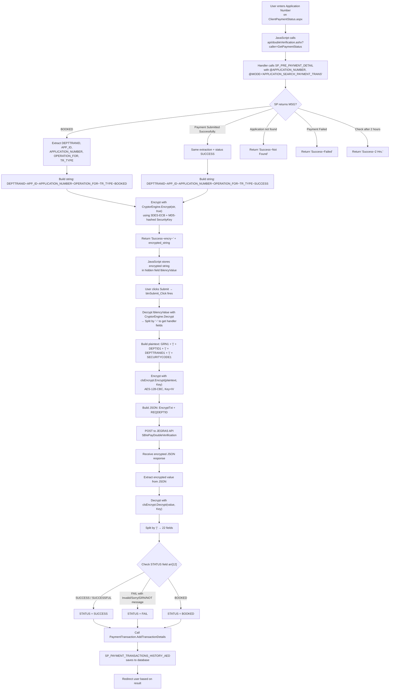

# Payment Double Verification Manual Guide

## Jharkhand Transport (JHT) – JEGRAS SBI ePay Double Verification

---

## 1. Executive Summary

This document traces the **complete payment double verification flow** in the Jharkhand Transport permit application (`Spermit_dev1`). The application integrates with the **Jharkhand Finance Department's JEGRAS** (Jharkhand e-Governance Receipts Accounting System) via a **WCF REST service** to verify SBI ePay payment transactions.

The system uses **two distinct encryption mechanisms**:

| Purpose | Class | Algorithm | Used For |
|---|---|---|---|
| Internal app-level encryption (query strings, page params) | `CryptorEngine` | Triple DES / ECB / PKCS7 (key MD5-hashed) | Passing data between pages via query strings |
| JEGRAS API encryption (double verification) | `clsEncrypt` | AES-128 / CBC / PKCS7 (IV = Key) | Encrypting/decrypting data sent to/from JEGRAS API |

> [!CAUTION]
> Multiple **critical security issues** were found — see [Section 18: Security Findings](#18-security-findings).

---

## 2. Exact API Endpoint

| Property | Value | Source |
|---|---|---|
| **Full URL** | `https://finance.jharkhand.gov.in/JEgrasDV/JeGrasRestful.svc/SBIePayDoubleVerification` | [ClientPaymentStatus.aspx.cs:61](file:///I:/Spermit_dev1/ClientPaymentStatus.aspx.cs#L61) |
| **HTTP Method** | `POST` | [ClientPaymentStatus.aspx.cs:67](file:///I:/Spermit_dev1/ClientPaymentStatus.aspx.cs#L67) |
| **Content-Type** | `application/json; charset=utf-8` | [ClientPaymentStatus.aspx.cs:65](file:///I:/Spermit_dev1/ClientPaymentStatus.aspx.cs#L65) |
| **Accept Header** | NOT FOUND IN SOURCE (not explicitly set) | — |
| **Timeout** | 30000 ms (30 seconds) | [ClientPaymentStatus.aspx.cs:66](file:///I:/Spermit_dev1/ClientPaymentStatus.aspx.cs#L66) |
| **TLS Version** | TLS 1.2 (set explicitly in `STA_CS_ALL_TAX_VERIFY`) | [STA_CS_ALL_TAX_VERIFY.aspx.cs:13](file:///I:/Spermit_dev1/STA_CS_ALL_TAX_VERIFY.aspx.cs#L13) |
| **Certificate Validation** | **DISABLED** (returns `true` always) | [ClientPaymentStatus.aspx.cs:26-29](file:///I:/Spermit_dev1/ClientPaymentStatus.aspx.cs#L26-L29) |
| **Proxy Configuration** | NOT FOUND IN SOURCE | — |
| **Authentication** | None (no auth headers set) | — |
| **Request Body Format** | JSON with two fields: `EncryptTxt` and `REQDEPTID` | — |
| **Request Encrypted** | Yes — the `EncryptTxt` field is AES-128 encrypted | — |

The same endpoint is used in three files:
- [ClientPaymentStatus.aspx.cs:61](file:///I:/Spermit_dev1/ClientPaymentStatus.aspx.cs#L61)
- [STA_COUNTERSIG_REPRINT.aspx.cs:60](file:///I:/Spermit_dev1/STA_COUNTERSIG_REPRINT.aspx.cs#L60)
- [STA_CS_ALL_TAX_VERIFY.aspx.cs:113](file:///I:/Spermit_dev1/STA_CS_ALL_TAX_VERIFY.aspx.cs#L113)

---

## 3. HTTP Method and Headers

```
POST https://finance.jharkhand.gov.in/JEgrasDV/JeGrasRestful.svc/SBIePayDoubleVerification
Content-Type: application/json; charset=utf-8
```

No additional custom headers are set in the source code.

---

## 4. Exact Request Format

The JSON body sent to the JEGRAS API:

```json
{
  "EncryptTxt": "<AES-128-CBC-encrypted-Base64-string>",
  "REQDEPTID": "JHTD"
}
```

**Source**: [ClientPaymentStatus.aspx.cs:60](file:///I:/Spermit_dev1/ClientPaymentStatus.aspx.cs#L60)

```csharp
json = "{\"EncryptTxt\": \"" + EncryptTxt + "\",\"REQDEPTID\": \"" + DEPTID1 + "\"}";
```

---

## 5. Request Field Mapping

### 5.1 Plaintext Before Encryption

The plaintext string that gets encrypted has this exact format:

```
GRN|DEPTID|DEPTTRANID|SECURITYCODE
```

**Delimiter**: `|` (pipe)

**Source**: [ClientPaymentStatus.aspx.cs:56](file:///I:/Spermit_dev1/ClientPaymentStatus.aspx.cs#L56)

```csharp
requestparameter = Convert.ToString(GRN1).Trim() + "|" + DEPTID1.ToString().Trim() + "|" 
    + DEPTTRANID1.ToString().Trim() + "|" + SECURITYCODE1.ToString().Trim();
```

Also confirmed in [PayGetWayDTO.cs:43](file:///I:/Spermit_dev1/App_Code/PayGetWayDTO.cs#L43):

```csharp
Data = GRN + "|" + DEPID + "|" + DEPTTRANDID + "|" + SECURITYCODE;
```

And [STA_CS_ALL_TAX_VERIFY.aspx.cs:100-101](file:///I:/Spermit_dev1/STA_CS_ALL_TAX_VERIFY.aspx.cs#L100-L101):

```csharp
string requestString = GRN + "|" + DEPTID + "|" + DEPTTRANID + "|" + SECURITYCODE;
```

### 5.2 Field Sources

| Field | Value | Source |
|---|---|---|
| **GRN** | Empty string `""` (for double verification) | [ClientPaymentStatus.aspx.cs:40](file:///I:/Spermit_dev1/ClientPaymentStatus.aspx.cs#L40): `string GRN1 = "";` |
| **DEPTID** | `"JHTD"` (hardcoded constant) | [ClientPaymentStatus.aspx.cs:41](file:///I:/Spermit_dev1/ClientPaymentStatus.aspx.cs#L41): `string DEPTID1 = "JHTD";` |
| **DEPTTRANID** | From SP `SP_PRE_PAYMENT_DETAIL` result column `DEPTTRANID` | [doubleVerification.ashx:64](file:///I:/Spermit_dev1/api/doubleVerification.ashx#L64) |
| **SECURITYCODE** | `<REDACTED>` — hardcoded in source | [ClientPaymentStatus.aspx.cs:51](file:///I:/Spermit_dev1/ClientPaymentStatus.aspx.cs#L51) |

### 5.3 JSON body fields

| JSON Field | Value | Source |
|---|---|---|
| `EncryptTxt` | AES-128-CBC encrypted, Base64-encoded `GRN\|DEPTID\|DEPTTRANID\|SECURITYCODE` | [ClientPaymentStatus.aspx.cs:57](file:///I:/Spermit_dev1/ClientPaymentStatus.aspx.cs#L57) |
| `REQDEPTID` | `"JHTD"` (plaintext) | [ClientPaymentStatus.aspx.cs:60](file:///I:/Spermit_dev1/ClientPaymentStatus.aspx.cs#L60) |

---

## 6. Encryption Algorithm

### 6.1 JEGRAS API Encryption: `clsEncrypt` (AES-128-CBC)

> [!IMPORTANT]
> This is the encryption used for **double verification** requests/responses with the JEGRAS API.

**Source file**: [clsEncrypt.cs](file:///I:/Spermit_dev1/App_Code/clsEncrypt.cs)

| Property | Value | Source Line |
|---|---|---|
| **Algorithm** | Rijndael (AES) | Line 20: `RijndaelManaged` |
| **Mode** | CBC | Line 22: `Mode = CipherMode.CBC` |
| **Padding** | PKCS7 | Line 23: `Padding = PaddingMode.PKCS7` |
| **Key Size** | 128 bits | Line 24: `KeySize = 128` |
| **Block Size** | 128 bits | Line 25: `BlockSize = 128` |
| **IV** | Same as Key (static, **not** dynamically generated) | Line 27: `IV = keyBytes` |
| **Key Derivation** | UTF-8 bytes of the key string, zero-padded/truncated to 16 bytes | Lines 17-19 |
| **Input Encoding** | UTF-8 | Line 42: `Encoding.UTF8.GetBytes(plainText)` |
| **Output Encoding** | Base64 | Line 43: `Convert.ToBase64String(...)` |
| **Key Hashing** | None (raw UTF-8 bytes used directly) | — |
| **URL Encoding** | Not applied by `clsEncrypt` itself | — |

**Key derivation logic** (Lines 17-19):
```csharp
var keyBytes = new byte[16];  // 16 bytes = 128 bits
var secretKeyBytes = Encoding.UTF8.GetBytes(secretKey);
Array.Copy(secretKeyBytes, keyBytes, Math.Min(keyBytes.Length, secretKeyBytes.Length));
```

This means: take the UTF-8 bytes of the key string, copy up to 16 bytes into a zero-initialized 16-byte array. If the key string is shorter than 16 bytes, the remaining bytes are `0x00`.

**Encryption key for JEGRAS API**: `<REDACTED>` — hardcoded in source code.

- Source: [ClientPaymentStatus.aspx.cs:52](file:///I:/Spermit_dev1/ClientPaymentStatus.aspx.cs#L52)
- Also in: [PayGetWayDTO.cs:28](file:///I:/Spermit_dev1/App_Code/PayGetWayDTO.cs#L28), [PayGetWayDTO.cs:45](file:///I:/Spermit_dev1/App_Code/PayGetWayDTO.cs#L45), [PayGetWayResponseDTO.cs:15](file:///I:/Spermit_dev1/App_Code/PayGetWayResponseDTO.cs#L15)

### 6.2 Internal Encryption: `CryptorEngine` (3DES-ECB)

> [!NOTE]
> This is used **only** for internal data passing between pages (query strings, hidden fields), NOT for the JEGRAS API communication.

**Source file**: [CryptorEngine.cs](file:///I:/Spermit_dev1/App_Code/Infrastructure/CryptorEngine.cs)

| Property | Value | Source Line |
|---|---|---|
| **Algorithm** | Triple DES | Line 31: `TripleDESCryptoServiceProvider` |
| **Mode** | ECB | Line 33: `tdes.Mode = CipherMode.ECB` |
| **Padding** | PKCS7 | Line 34: `tdes.Padding = PaddingMode.PKCS7` |
| **Key Derivation** | MD5 hash of key string (when `useHashing = true`) | Lines 24-26 |
| **Input Encoding** | UTF-8 | Line 14 |
| **Output Encoding** | Base64 | Line 39 |
| **Key Source** | `web.config` → `appSettings` → `SecurityKey` | Lines 18-20 |

**Configuration key**: `SecurityKey` in web.config → `<REDACTED>`

---

## 7. Encryption/Decryption Implementation

### 7.1 clsEncrypt — Full Implementation (JEGRAS API)

```csharp
// Source: App_Code/clsEncrypt.cs
public RijndaelManaged GetRijndaelManaged(String secretKey)
{
    var keyBytes = new byte[16];
    var secretKeyBytes = Encoding.UTF8.GetBytes(secretKey);
    Array.Copy(secretKeyBytes, keyBytes, Math.Min(keyBytes.Length, secretKeyBytes.Length));
    return new RijndaelManaged
    {
        Mode = CipherMode.CBC,
        Padding = PaddingMode.PKCS7,
        KeySize = 128,
        BlockSize = 128,
        Key = keyBytes,
        IV = keyBytes   // IV is identical to the Key
    };
}

public String Encrypt(String plainText, String key)
{
    var plainBytes = Encoding.UTF8.GetBytes(plainText);
    return Convert.ToBase64String(Encrypt(plainBytes, GetRijndaelManaged(key)));
}

public String Decrypt(String encryptedText, String key)
{
    var encryptedBytes = Convert.FromBase64String(encryptedText);
    return Encoding.UTF8.GetString(Decrypt(encryptedBytes, GetRijndaelManaged(key)));
}
```

### 7.2 CryptorEngine — Full Implementation (Internal)

```csharp
// Source: App_Code/Infrastructure/CryptorEngine.cs
public static string Encrypt(string toEncrypt, bool useHashing)
{
    byte[] keyArray;
    byte[] toEncryptArray = UTF8Encoding.UTF8.GetBytes(toEncrypt);

    AppSettingsReader settingsReader = new AppSettingsReader();
    string key = (string)settingsReader.GetValue("SecurityKey", typeof(String));

    if (useHashing)
    {
        MD5CryptoServiceProvider hashmd5 = new MD5CryptoServiceProvider();
        keyArray = hashmd5.ComputeHash(UTF8Encoding.UTF8.GetBytes(key));
        hashmd5.Clear();
    }
    else
        keyArray = UTF8Encoding.UTF8.GetBytes(key);

    TripleDESCryptoServiceProvider tdes = new TripleDESCryptoServiceProvider();
    tdes.Key = keyArray;
    tdes.Mode = CipherMode.ECB;
    tdes.Padding = PaddingMode.PKCS7;

    ICryptoTransform cTransform = tdes.CreateEncryptor();
    byte[] resultArray = cTransform.TransformFinalBlock(toEncryptArray, 0, toEncryptArray.Length);
    tdes.Clear();
    return Convert.ToBase64String(resultArray, 0, resultArray.Length);
}
```

---

## 8. Secret/Configuration Sources

| Name | Source File | Section/Key | Used By | Example Value |
|---|---|---|---|---|
| **JEGRAS API Encryption Key** | Hardcoded in source | Multiple `.cs` files | `clsEncrypt.Encrypt/Decrypt` | `<REDACTED>` |
| **JEGRAS Security Code** | Hardcoded in source | Multiple `.cs` files | Request parameter `SECURITYCODE` | `<REDACTED>` |
| **CryptorEngine SecurityKey** | [web.config](file:///I:/Spermit_dev1/web.config#L9) | `appSettings → SecurityKey` | `CryptorEngine.Encrypt/Decrypt` | `<REDACTED>` |
| **Connection String** | [web.config](file:///I:/Spermit_dev1/web.config#L12) | `connectionStrings → connectionstring` | `SQLHelper.GetConnString()` | `<REDACTED>` |
| **Department ID** | Hardcoded in source | Various `.cs` files | `DEPTID` / `REQDEPTID` | `JHTD` |
| **API URL** | Hardcoded in source | `ClientPaymentStatus.aspx.cs:61` etc. | HTTP request target | `https://finance.jharkhand.gov.in/JEgrasDV/JeGrasRestful.svc/SBIePayDoubleVerification` |
| **PrefixKey** | [web.config](file:///I:/Spermit_dev1/web.config#L8) | `appSettings → PrefixKey` | NOT FOUND IN SOURCE used for payment | `Jht_` |

---

## 9. Raw Response Format

The JEGRAS API returns a **JSON response** containing an encrypted string.

**Source**: [ClientPaymentStatus.aspx.cs:75-83](file:///I:/Spermit_dev1/ClientPaymentStatus.aspx.cs#L75-L83)

```csharp
WebResponse response = request.GetResponse();
var streamReader = new StreamReader(response.GetResponseStream());
string result = streamReader.ReadToEnd();

// Response processing:
EncryptResponse = result.Replace(@"\", "");
int i = EncryptResponse.IndexOf(":") + 2;
string actualval = EncryptResponse.Substring(i, EncryptResponse.Length - i - 2);
```

### Expected raw response structure:

```json
{"SBIePayDoubleVerificationResult":"<Base64-AES-128-encrypted-response>"}
```

### Response extraction logic:

1. Remove all backslash characters: `.Replace(@"\", "")`
2. Find the first `:` character
3. Skip 2 characters after `:` (to skip `: "`)
4. Extract from that position to `length - 2` (to remove trailing `"`)
5. The resulting string is the **Base64-encoded AES-encrypted response**

---

## 10. Decrypted Response Format

After decryption, the response is a **pipe-delimited** (`|`) string:

```
DEPTID|RECIEPTHEADCODE|DEPOSITERNAME|DEPTTRANID|AMOUNT|DEPOSITERID|PANNO|ADDINFO1|ADDINFO2|ADDINFO3|TREASCODE|IFMSOFFICECODE|STATUS|PAYMENTSTATUSMESSAGE|GRN|CIN|REF_NO|TXN_DATE|TXN_AMOUNT|CHALLAN_URL|PMODE|ADDINFO5
```

Decryption code: [ClientPaymentStatus.aspx.cs:86](file:///I:/Spermit_dev1/ClientPaymentStatus.aspx.cs#L86)

```csharp
String DecryptedVal = encdept.Decrypt(actualval, Key);
String[] arr = DecryptedVal.Split('|');
```

---

## 11. Response Field Mapping

| Index | Field Name | Meaning | Source Code Reference |
|---|---|---|---|
| 0 | `DEPTID` | Department ID | [ClientPaymentStatus.aspx.cs:92](file:///I:/Spermit_dev1/ClientPaymentStatus.aspx.cs#L92) |
| 1 | `RECIEPTHEADCODE` | Receipt head code | [ClientPaymentStatus.aspx.cs:93](file:///I:/Spermit_dev1/ClientPaymentStatus.aspx.cs#L93) |
| 2 | `DEPOSITERNAME` | Depositor / applicant name | [ClientPaymentStatus.aspx.cs:94](file:///I:/Spermit_dev1/ClientPaymentStatus.aspx.cs#L94) |
| 3 | `DEPTTRANID` | Department transaction ID | [ClientPaymentStatus.aspx.cs:95](file:///I:/Spermit_dev1/ClientPaymentStatus.aspx.cs#L95) |
| 4 | `AMOUNT` | Transaction amount | [ClientPaymentStatus.aspx.cs:97-101](file:///I:/Spermit_dev1/ClientPaymentStatus.aspx.cs#L97-L101) |
| 5 | `DEPOSITERID` | Application number / depositor ID | [ClientPaymentStatus.aspx.cs:103](file:///I:/Spermit_dev1/ClientPaymentStatus.aspx.cs#L103) |
| 6 | `PANNO` | PAN number | [ClientPaymentStatus.aspx.cs:104](file:///I:/Spermit_dev1/ClientPaymentStatus.aspx.cs#L104) |
| 7 | `ADDINFO1` | Operation type (e.g. "STA COUNTER SIGNATURE TAX PAY") | [ClientPaymentStatus.aspx.cs:105](file:///I:/Spermit_dev1/ClientPaymentStatus.aspx.cs#L105) |
| 8 | `ADDINFO2` | APP_ID | [ClientPaymentStatus.aspx.cs:107](file:///I:/Spermit_dev1/ClientPaymentStatus.aspx.cs#L107) |
| 9 | `ADDINFO3` | TR_TYPE (transaction type) | [ClientPaymentStatus.aspx.cs:108](file:///I:/Spermit_dev1/ClientPaymentStatus.aspx.cs#L108) |
| 10 | `TREASCODE` | Treasury code | [ClientPaymentStatus.aspx.cs:109](file:///I:/Spermit_dev1/ClientPaymentStatus.aspx.cs#L109) |
| 11 | `IFMSOFFICECODE` | IFMS office code | [ClientPaymentStatus.aspx.cs:110](file:///I:/Spermit_dev1/ClientPaymentStatus.aspx.cs#L110) |
| 12 | `STATUS` | Payment status (`SUCCESS`, `SUCCESSFUL`, `FAIL`, `BOOKED`) | [ClientPaymentStatus.aspx.cs:111](file:///I:/Spermit_dev1/ClientPaymentStatus.aspx.cs#L111) |
| 13 | `PAYMENTSTATUSMESSAGE` | Detailed status message | [ClientPaymentStatus.aspx.cs:114](file:///I:/Spermit_dev1/ClientPaymentStatus.aspx.cs#L114) |
| 14 | `GRN` | Government Receipt Number | [ClientPaymentStatus.aspx.cs:115](file:///I:/Spermit_dev1/ClientPaymentStatus.aspx.cs#L115) |
| 15 | `CIN` | Challan Identification Number | [ClientPaymentStatus.aspx.cs:116](file:///I:/Spermit_dev1/ClientPaymentStatus.aspx.cs#L116) |
| 16 | `REF_NO` | Transaction reference number | [ClientPaymentStatus.aspx.cs:117](file:///I:/Spermit_dev1/ClientPaymentStatus.aspx.cs#L117) |
| 17 | `TXN_DATE` | Transaction date | [ClientPaymentStatus.aspx.cs:118](file:///I:/Spermit_dev1/ClientPaymentStatus.aspx.cs#L118) |
| 18 | `TXN_AMOUNT` | Transaction amount (confirmed) | [ClientPaymentStatus.aspx.cs:119](file:///I:/Spermit_dev1/ClientPaymentStatus.aspx.cs#L119) |
| 19 | `CHALLAN_URL` | Challan URL | [ClientPaymentStatus.aspx.cs:125](file:///I:/Spermit_dev1/ClientPaymentStatus.aspx.cs#L125) |
| 20 | `PMODE` | Payment mode | [ClientPaymentStatus.aspx.cs:126](file:///I:/Spermit_dev1/ClientPaymentStatus.aspx.cs#L126) |
| 21 | `ADDINFO5` | Additional info 5 | [ClientPaymentStatus.aspx.cs:127](file:///I:/Spermit_dev1/ClientPaymentStatus.aspx.cs#L127) |

Also confirmed in [PaymentResponse.aspx.cs:45-70](file:///I:/Spermit_dev1/PaymentResponse.aspx.cs#L45-L70) which uses the identical mapping without safe bounds checking.

---

## 12. Complete Payment Verification Flow



### Step-by-Step Source Files

| Step | Description | File | Method/Line |
|---|---|---|---|
| 1 | User enters application number | [ClientPaymentStatus.aspx](file:///I:/Spermit_dev1/ClientPaymentStatus.aspx#L49) | HTML input `txtApplicationNo` |
| 2 | JavaScript AJAX call to handler | [ClientPaymentStatus.aspx](file:///I:/Spermit_dev1/ClientPaymentStatus.aspx#L108-L110) | `fnValidate()` → `$.ajax()` |
| 3 | Handler queries SP | [doubleVerification.ashx](file:///I:/Spermit_dev1/api/doubleVerification.ashx#L42-L46) | `SP_PRE_PAYMENT_DETAIL` |
| 4 | Handler builds encrypted response | [doubleVerification.ashx](file:///I:/Spermit_dev1/api/doubleVerification.ashx#L64-L71) | `CryptorEngine.Encrypt()` |
| 5 | JavaScript stores encrypted value | [ClientPaymentStatus.aspx](file:///I:/Spermit_dev1/ClientPaymentStatus.aspx#L139) | `$('input[id*=lblencyValue]').val(encryData)` |
| 6 | User clicks Submit | [ClientPaymentStatus.aspx.cs](file:///I:/Spermit_dev1/ClientPaymentStatus.aspx.cs#L32) | `btnSubmit_Click` |
| 7 | Decrypt handler data | [ClientPaymentStatus.aspx.cs](file:///I:/Spermit_dev1/ClientPaymentStatus.aspx.cs#L43) | `CryptorEngine.Decrypt()` |
| 8 | Build verification request | [ClientPaymentStatus.aspx.cs](file:///I:/Spermit_dev1/ClientPaymentStatus.aspx.cs#L56) | String concatenation with `\|` |
| 9 | Encrypt request | [ClientPaymentStatus.aspx.cs](file:///I:/Spermit_dev1/ClientPaymentStatus.aspx.cs#L57) | `encdept.Encrypt(requestparameter, Key)` |
| 10 | Build JSON body | [ClientPaymentStatus.aspx.cs](file:///I:/Spermit_dev1/ClientPaymentStatus.aspx.cs#L60) | JSON string construction |
| 11 | POST to JEGRAS | [ClientPaymentStatus.aspx.cs](file:///I:/Spermit_dev1/ClientPaymentStatus.aspx.cs#L64-L73) | `HttpWebRequest` POST |
| 12 | Read response | [ClientPaymentStatus.aspx.cs](file:///I:/Spermit_dev1/ClientPaymentStatus.aspx.cs#L75-L77) | `StreamReader.ReadToEnd()` |
| 13 | Extract encrypted value | [ClientPaymentStatus.aspx.cs](file:///I:/Spermit_dev1/ClientPaymentStatus.aspx.cs#L81-L83) | Substring extraction |
| 14 | Decrypt response | [ClientPaymentStatus.aspx.cs](file:///I:/Spermit_dev1/ClientPaymentStatus.aspx.cs#L86) | `encdept.Decrypt(actualval, Key)` |
| 15 | Parse fields | [ClientPaymentStatus.aspx.cs](file:///I:/Spermit_dev1/ClientPaymentStatus.aspx.cs#L91-L127) | `Split('\|')` |
| 16 | Save to database | [PaymentTransaction.cs](file:///I:/Spermit_dev1/App_Code/PaymentTransaction.cs#L60) | `SP_PAYMENT_TRANSACTIONS_HISTORY_AED` |

---

## 13. Working curl Template

> [!WARNING]
> You must first generate the encrypted `EncryptTxt` value using the exact AES-128-CBC algorithm described in Section 6. The curl command alone cannot perform the encryption.

### Step 1: Generate the encrypted request

Plaintext to encrypt:

```
<GRN>|JHTD|<DEPTTRANID>|<SECURITY_CODE>
```

For double verification, GRN is typically empty, so:

```
|JHTD|<DEPTTRANID>|<SECURITY_CODE>
```

### Step 2: curl command

```bash
curl -X POST \
  "https://finance.jharkhand.gov.in/JEgrasDV/JeGrasRestful.svc/SBIePayDoubleVerification" \
  -H "Content-Type: application/json; charset=utf-8" \
  --tlsv1.2 \
  --max-time 30 \
  -d '{"EncryptTxt": "<ENCRYPTED_BASE64_VALUE>", "REQDEPTID": "JHTD"}'
```

### How placeholders are populated:

| Placeholder | Source |
|---|---|
| `<DEPTTRANID>` | From `SP_PRE_PAYMENT_DETAIL` result, column `DEPTTRANID` — or from the transaction record in the database |
| `<GRN>` | From `SP_PRE_PAYMENT_DETAIL` result, column `GRN` — usually empty `""` for verification of non-receipted transactions |
| `<SECURITY_CODE>` | Hardcoded in source: [ClientPaymentStatus.aspx.cs:51](file:///I:/Spermit_dev1/ClientPaymentStatus.aspx.cs#L51) — `<REDACTED>` |
| `<ENCRYPTION_KEY>` | Hardcoded in source: [ClientPaymentStatus.aspx.cs:52](file:///I:/Spermit_dev1/ClientPaymentStatus.aspx.cs#L52) — `<REDACTED>` |
| `<ENCRYPTED_BASE64_VALUE>` | Output of `clsEncrypt.Encrypt(plaintext, <ENCRYPTION_KEY>)` |

---

## 14. Standalone Manual Verification Script

### Python Script

```python
#!/usr/bin/env python3
"""
Manual Payment Double Verification Script
Jharkhand Transport — JEGRAS SBI ePay

USAGE:
  Set environment variables before running:
    PAYMENT_ENCRYPTION_KEY   — The AES key used by clsEncrypt (from source code)
    PAYMENT_SECURITY_CODE    — The SECURITYCODE value (from source code)

  python verify_payment.py <DEPTTRANID> [GRN]

  Example:
    python verify_payment.py 639256615327531962

This script replicates the EXACT encryption used by the application:
  - Algorithm: AES-128 (Rijndael)
  - Mode: CBC
  - Padding: PKCS7
  - Key: UTF-8 bytes of key string, zero-padded to 16 bytes
  - IV: Same as Key
  - Output: Base64
"""

import os
import sys
import json
import base64
import requests
from Crypto.Cipher import AES
from Crypto.Util.Padding import pad, unpad

# ─── Configuration ───────────────────────────────────────────────
DEPTID = "JHTD"
API_URL = "https://finance.jharkhand.gov.in/JEgrasDV/JeGrasRestful.svc/SBIePayDoubleVerification"
TIMEOUT = 30

# ─── Key derivation (exact replication of clsEncrypt.GetRijndaelManaged) ───
def derive_key(secret_key: str) -> bytes:
    """
    Replicates clsEncrypt.cs lines 17-19:
      var keyBytes = new byte[16];
      var secretKeyBytes = Encoding.UTF8.GetBytes(secretKey);
      Array.Copy(secretKeyBytes, keyBytes, Math.Min(keyBytes.Length, secretKeyBytes.Length));
    """
    key_bytes = secret_key.encode('utf-8')
    result = bytearray(16)  # zero-initialized
    copy_len = min(16, len(key_bytes))
    result[:copy_len] = key_bytes[:copy_len]
    return bytes(result)


def encrypt_aes128_cbc(plaintext: str, secret_key: str) -> str:
    """
    Replicates clsEncrypt.Encrypt(String plainText, String key)
    AES-128-CBC, PKCS7 padding, IV = Key, output = Base64
    """
    key = derive_key(secret_key)
    iv = key  # IV is identical to Key
    cipher = AES.new(key, AES.MODE_CBC, iv)
    padded = pad(plaintext.encode('utf-8'), AES.block_size)
    encrypted = cipher.encrypt(padded)
    return base64.b64encode(encrypted).decode('utf-8')


def decrypt_aes128_cbc(ciphertext_b64: str, secret_key: str) -> str:
    """
    Replicates clsEncrypt.Decrypt(String encryptedText, String key)
    AES-128-CBC, PKCS7 padding, IV = Key, input = Base64
    """
    key = derive_key(secret_key)
    iv = key
    cipher = AES.new(key, AES.MODE_CBC, iv)
    encrypted = base64.b64decode(ciphertext_b64)
    decrypted = unpad(cipher.decrypt(encrypted), AES.block_size)
    return decrypted.decode('utf-8')


def extract_encrypted_value(raw_response: str) -> str:
    """
    Replicates ClientPaymentStatus.aspx.cs lines 81-83:
      EncryptResponse = result.Replace(@"\\", "");
      int i = EncryptResponse.IndexOf(":") + 2;
      string actualval = EncryptResponse.Substring(i, EncryptResponse.Length - i - 2);
    """
    cleaned = raw_response.replace("\\", "")
    colon_idx = cleaned.index(":")
    start = colon_idx + 2
    return cleaned[start:-2]


def main():
    # ─── Read secrets from environment ───
    encryption_key = os.environ.get("PAYMENT_ENCRYPTION_KEY")
    security_code = os.environ.get("PAYMENT_SECURITY_CODE")

    if not encryption_key or not security_code:
        print("ERROR: Set PAYMENT_ENCRYPTION_KEY and PAYMENT_SECURITY_CODE environment variables")
        sys.exit(1)

    # ─── Parse arguments ───
    if len(sys.argv) < 2:
        print("Usage: python verify_payment.py <DEPTTRANID> [GRN]")
        sys.exit(1)

    depttranid = sys.argv[1]
    grn = sys.argv[2] if len(sys.argv) > 2 else ""

    # ─── Step 1: Build plaintext request ───
    # Format: GRN|DEPTID|DEPTTRANID|SECURITYCODE
    plaintext = f"{grn}|{DEPTID}|{depttranid}|{security_code}"
    print(f"[1] Plaintext request: {grn}|{DEPTID}|{depttranid}|<REDACTED>")

    # ─── Step 2: Encrypt ───
    encrypted = encrypt_aes128_cbc(plaintext, encryption_key)
    print(f"[2] Encrypted (Base64): {encrypted}")

    # ─── Step 3: Build JSON body ───
    json_body = {
        "EncryptTxt": encrypted,
        "REQDEPTID": DEPTID
    }
    print(f"[3] JSON body: {json.dumps(json_body)}")

    # ─── Step 4: Send HTTP request ───
    print(f"[4] Sending POST to {API_URL} ...")
    headers = {"Content-Type": "application/json; charset=utf-8"}

    try:
        resp = requests.post(
            API_URL,
            json=json_body,
            headers=headers,
            timeout=TIMEOUT,
            verify=True  # Enable TLS verification (unlike the app which disables it!)
        )
    except requests.exceptions.RequestException as e:
        print(f"ERROR: HTTP request failed: {e}")
        sys.exit(1)

    # ─── Step 5: Print raw response ───
    print(f"[5] HTTP Status: {resp.status_code}")
    print(f"[5] Raw response: {resp.text}")

    # ─── Step 6: Extract encrypted value ───
    try:
        encrypted_response = extract_encrypted_value(resp.text)
        print(f"[6] Extracted encrypted value: {encrypted_response[:80]}...")
    except Exception as e:
        print(f"ERROR: Could not extract encrypted value: {e}")
        sys.exit(1)

    # ─── Step 7: Decrypt response ───
    try:
        decrypted = decrypt_aes128_cbc(encrypted_response, encryption_key)
        print(f"[7] Decrypted response: {decrypted}")
    except Exception as e:
        print(f"ERROR: Decryption failed: {e}")
        sys.exit(1)

    # ─── Step 8: Parse fields ───
    fields = decrypted.split("|")
    print(f"\n{'='*60}")
    print(f"PARSED RESPONSE ({len(fields)} fields)")
    print(f"{'='*60}")

    field_names = [
        "DEPTID", "RECIEPTHEADCODE", "DEPOSITERNAME", "DEPTTRANID",
        "AMOUNT", "DEPOSITERID", "PANNO", "ADDINFO1",
        "ADDINFO2", "ADDINFO3", "TREASCODE", "IFMSOFFICECODE",
        "STATUS", "PAYMENTSTATUSMESSAGE", "GRN", "CIN",
        "REF_NO", "TXN_DATE", "TXN_AMOUNT", "CHALLAN_URL",
        "PMODE", "ADDINFO5"
    ]

    for i, val in enumerate(fields):
        name = field_names[i] if i < len(field_names) else f"FIELD_{i}"
        print(f"  [{i:2d}] {name:25s} = {val}")

    # ─── Step 9: Print key results ───
    print(f"\n{'='*60}")
    print("KEY RESULTS")
    print(f"{'='*60}")

    status = fields[12] if len(fields) > 12 else "N/A"
    print(f"  Payment Status        : {status}")
    print(f"  Status Message        : {fields[13] if len(fields) > 13 else 'N/A'}")
    print(f"  GRN                   : {fields[14] if len(fields) > 14 else 'N/A'}")
    print(f"  Transaction Reference : {fields[16] if len(fields) > 16 else 'N/A'}")
    print(f"  Transaction Date      : {fields[17] if len(fields) > 17 else 'N/A'}")
    print(f"  Transaction Amount    : {fields[18] if len(fields) > 18 else 'N/A'}")


if __name__ == "__main__":
    main()
```

### Requirements

```
pip install pycryptodome requests
```

### Usage

```bash
export PAYMENT_ENCRYPTION_KEY="<your_key_from_source>"
export PAYMENT_SECURITY_CODE="<your_security_code_from_source>"

python verify_payment.py 639256615327531962
# or with GRN:
python verify_payment.py 639256615327531962 "12345"
```

---

## 15. Postman Configuration

### Request

| Setting | Value |
|---|---|
| **Method** | POST |
| **URL** | `https://finance.jharkhand.gov.in/JEgrasDV/JeGrasRestful.svc/SBIePayDoubleVerification` |
| **Content-Type** | `application/json; charset=utf-8` |

### Body (raw JSON)

```json
{
  "EncryptTxt": "{{encrypted_request}}",
  "REQDEPTID": "JHTD"
}
```

### Environment Variables

| Variable | Value |
|---|---|
| `encryption_key` | `<set_from_source_code>` |
| `security_code` | `<set_from_source_code>` |
| `dept_tran_id` | `<your_transaction_id>` |
| `grn` | `` (empty for verification) |
| `dept_id` | `JHTD` |

### Pre-request Script (JavaScript)

```javascript
// Replicates clsEncrypt.Encrypt — AES-128-CBC, PKCS7, IV=Key, Base64 output
// Requires: CryptoJS library (available in Postman)

const CryptoJS = require('crypto-js');

// Read from Postman environment
const encryptionKey = pm.environment.get("encryption_key");
const securityCode = pm.environment.get("security_code");
const deptTranId = pm.environment.get("dept_tran_id");
const grn = pm.environment.get("grn") || "";
const deptId = pm.environment.get("dept_id") || "JHTD";

// Build plaintext: GRN|DEPTID|DEPTTRANID|SECURITYCODE
const plaintext = grn + "|" + deptId + "|" + deptTranId + "|" + securityCode;

// Key derivation: UTF-8 bytes, zero-padded to 16 bytes
function deriveKey(keyStr) {
    const keyUtf8 = CryptoJS.enc.Utf8.parse(keyStr);
    const keyBytes = CryptoJS.lib.WordArray.create(new ArrayBuffer(16));
    const copyLen = Math.min(keyUtf8.sigBytes, 16);
    for (let i = 0; i < copyLen; i++) {
        const byte = (keyUtf8.words[Math.floor(i / 4)] >>> (24 - (i % 4) * 8)) & 0xFF;
        keyBytes.words[Math.floor(i / 4)] |= (byte << (24 - (i % 4) * 8));
    }
    keyBytes.sigBytes = 16;
    return keyBytes;
}

const key = deriveKey(encryptionKey);
const iv = key.clone();  // IV = Key

const encrypted = CryptoJS.AES.encrypt(plaintext, key, {
    iv: iv,
    mode: CryptoJS.mode.CBC,
    padding: CryptoJS.pad.Pkcs7
});

const encryptedBase64 = encrypted.toString();  // Base64 output

pm.environment.set("encrypted_request", encryptedBase64);
console.log("Plaintext:", plaintext);
console.log("Encrypted:", encryptedBase64);
```

### Tests Script (Post-response)

```javascript
// Decrypt the JEGRAS response
const CryptoJS = require('crypto-js');

const encryptionKey = pm.environment.get("encryption_key");

function deriveKey(keyStr) {
    const keyUtf8 = CryptoJS.enc.Utf8.parse(keyStr);
    const keyBytes = CryptoJS.lib.WordArray.create(new ArrayBuffer(16));
    const copyLen = Math.min(keyUtf8.sigBytes, 16);
    for (let i = 0; i < copyLen; i++) {
        const byte = (keyUtf8.words[Math.floor(i / 4)] >>> (24 - (i % 4) * 8)) & 0xFF;
        keyBytes.words[Math.floor(i / 4)] |= (byte << (24 - (i % 4) * 8));
    }
    keyBytes.sigBytes = 16;
    return keyBytes;
}

try {
    let raw = pm.response.text();
    
    // Extract encrypted value (same logic as C# code)
    raw = raw.replace(/\\/g, "");
    const colonIdx = raw.indexOf(":");
    const encryptedVal = raw.substring(colonIdx + 2, raw.length - 2);
    
    const key = deriveKey(encryptionKey);
    const iv = key.clone();
    
    const decrypted = CryptoJS.AES.decrypt(encryptedVal, key, {
        iv: iv,
        mode: CryptoJS.mode.CBC,
        padding: CryptoJS.pad.Pkcs7
    });
    
    const decryptedStr = decrypted.toString(CryptoJS.enc.Utf8);
    const fields = decryptedStr.split("|");
    
    const fieldNames = [
        "DEPTID", "RECIEPTHEADCODE", "DEPOSITERNAME", "DEPTTRANID",
        "AMOUNT", "DEPOSITERID", "PANNO", "ADDINFO1",
        "ADDINFO2", "ADDINFO3", "TREASCODE", "IFMSOFFICECODE",
        "STATUS", "PAYMENTSTATUSMESSAGE", "GRN", "CIN",
        "REF_NO", "TXN_DATE", "TXN_AMOUNT", "CHALLAN_URL",
        "PMODE", "ADDINFO5"
    ];
    
    console.log("=== DECRYPTED RESPONSE ===");
    console.log("Full:", decryptedStr);
    console.log("");
    
    fields.forEach((val, i) => {
        const name = i < fieldNames.length ? fieldNames[i] : `FIELD_${i}`;
        console.log(`[${i}] ${name} = ${val}`);
    });
    
    console.log("");
    console.log("STATUS:", fields[12] || "N/A");
    console.log("MESSAGE:", fields[13] || "N/A");
    console.log("GRN:", fields[14] || "N/A");
    console.log("TXN_AMOUNT:", fields[18] || "N/A");
    
    // Set test results
    pm.test("Status is present", () => {
        pm.expect(fields.length).to.be.above(12);
    });
    
} catch (e) {
    console.error("Decryption error:", e.message);
}
```

---

## 16. Example for JH-CS-RP-0227

### Transaction details provided:

| Field | Value |
|---|---|
| Application Number | `JH-CS-RP-0227` |
| Transaction ID (database) | `83456` |
| DEPTTRANID | `639256615327531962` |
| Amount | `14625.00` |
| Current Status | `FAIL` |
| TRN_MESSAGE | `Grn No is Invalid or not Exist` |

### Analysis

1. **The `TRN_MESSAGE` "Grn No is Invalid or not Exist"** — This message originates from the JEGRAS API response, not from the application itself. It means the JEGRAS system did not find a valid GRN for this transaction.

2. **GRN is expected to be empty for double verification requests**:
   - In [ClientPaymentStatus.aspx.cs:40](file:///I:/Spermit_dev1/ClientPaymentStatus.aspx.cs#L40): `string GRN1 = "";`
   - The GRN field in the request plaintext is set to empty string
   - This is intentional — the double verification is querying by `DEPTTRANID`, not by GRN

3. **Why the status is FAIL**:
   - The response `STATUS` (index 12) was `FAIL`
   - The `PAYMENTSTATUSMESSAGE` (index 13) contained "Grn No is Invalid or not Exist"
   - This matches the fail condition in [ClientPaymentStatus.aspx.cs:133-134](file:///I:/Spermit_dev1/ClientPaymentStatus.aspx.cs#L133-L134):
     ```csharp
     (statusUpper == "FAIL" && (PAYMENTSTATUSMESSAGE.ToUpper().Contains("INVALID") 
         || PAYMENTSTATUSMESSAGE.ToUpper().Contains("GRN") 
         || PAYMENTSTATUSMESSAGE.ToUpper().Contains("NOT")))
     ```
   - This condition matches on **three** keywords: "INVALID", "GRN", and "NOT"
   - When this condition is true, the code sets `TXN_AMOUNT = "0"` and `STATUS = "FAIL"` (line 142)

4. **To manually verify this transaction**, run:

```bash
export PAYMENT_ENCRYPTION_KEY="<from_source_code>"
export PAYMENT_SECURITY_CODE="<from_source_code>"
python verify_payment.py 639256615327531962
```

> [!IMPORTANT]
> **Do NOT modify this transaction.** Use the script in read-only mode to see what the JEGRAS API currently returns for this `DEPTTRANID`.

### Expected Plaintext Request

```
|JHTD|639256615327531962|<REDACTED_SECURITY_CODE>
```

The GRN portion before the first `|` is empty, which is normal for verification — the JEGRAS API should look up the GRN by `DEPTTRANID`.

### Possible Explanations for "Grn No is Invalid or not Exist"

1. The transaction was never completed at the payment gateway (SBI) side
2. The GRN was not generated by JEGRAS for this transaction
3. The `DEPTTRANID` is not recognized by the JEGRAS system
4. The transaction timed out before a GRN could be assigned
5. Network or system issues during the original payment flow

---

## 17. Troubleshooting Guide

### Common Failure Patterns

| Error Message | Meaning | Action |
|---|---|---|
| `Grn No is Invalid or not Exist` | JEGRAS API doesn't recognize the DEPTTRANID or no GRN was generated | Check if the payment was initiated but never completed at SBI. Contact Finance Dept with DEPTTRANID |
| `Application not found` | SP_PRE_PAYMENT_DETAIL returns no data for this application number | Verify the application number exists in the database |
| `Payment Failed Please Try Again Later.` | Previous transaction already marked as FAIL | User can retry payment from the application page |
| `Please Check Payment Detail after 2 hours.` | Transaction is in BOOKED state and less than 2 hours old | Wait and check again |
| Decryption errors | Base64 corruption (spaces replacing `+`) | URL-decode the value and replace spaces with `+` before decryption (as done in [STA_CS_ALL_TAX_VERIFY.aspx.cs:51-52](file:///I:/Spermit_dev1/STA_CS_ALL_TAX_VERIFY.aspx.cs#L51-L52)) |
| Empty/invalid API response | JEGRAS service is down or unreachable | Check network connectivity to `finance.jharkhand.gov.in`, check TLS 1.2 support |

### How to check the raw stored procedure output

```sql
EXEC SP_PRE_PAYMENT_DETAIL 
    @APPLICATION_NUMBER = 'JH-CS-RP-0227', 
    @MODE = 'APPLICATION_SEARCH_PAYMENT_TRANS';
```

This SP returns a `MSG` column with one of these values:
- `Application not found`
- `Payment Submitted Successfully.`
- `Please Check Payment Detail after 2 hours.`
- `Payment Failed Please Try Again Later.`
- `BOOKED`

When MSG is `BOOKED` or `Payment Submitted Successfully.`, the SP also returns: `DEPTTRANID`, `APP_ID`, `APPLICATION_NUMBER`, `OPERATION_FOR`, `TR_TYPE`.

### Database transaction check

```sql
-- Check the transaction history for this application
-- (Stored procedure SP_PAYMENT_TRANSACTIONS_HISTORY_AED 
--  is called by PaymentTransaction.AddTransactionDetails)
-- Look for the transaction with ID 83456 in the relevant table
```

> [!NOTE]
> The stored procedure `SP_PRE_PAYMENT_DETAIL` and `SP_PAYMENT_TRANSACTIONS_HISTORY_AED` are defined in the database and NOT found as `.sql` files in the repository. The only SQL file in the repository is [RTA_MODERATOR_USER_MANAGEMENT_SETUP.sql](file:///I:/Spermit_dev1/RTA_MODERATOR_USER_MANAGEMENT_SETUP.sql) which is unrelated to payments.

---

## 18. Security Findings

> [!CAUTION]
> The following security issues were identified in the source code. **No real secret values are reproduced below.**

### 18.1 Hardcoded Encryption Keys

| Finding | Severity | Files |
|---|---|---|
| **JEGRAS API encryption key hardcoded in source** | 🔴 CRITICAL | [ClientPaymentStatus.aspx.cs:52](file:///I:/Spermit_dev1/ClientPaymentStatus.aspx.cs#L52), [STA_COUNTERSIG_REPRINT.aspx.cs:53](file:///I:/Spermit_dev1/STA_COUNTERSIG_REPRINT.aspx.cs#L53), [STA_CS_ALL_TAX_VERIFY.aspx.cs:96](file:///I:/Spermit_dev1/STA_CS_ALL_TAX_VERIFY.aspx.cs#L96), [PayGetWayDTO.cs:28,45](file:///I:/Spermit_dev1/App_Code/PayGetWayDTO.cs#L28), [PayGetWayResponseDTO.cs:15](file:///I:/Spermit_dev1/App_Code/PayGetWayResponseDTO.cs#L15), [EncryptDecrypt.aspx.cs:31,40](file:///I:/Spermit_dev1/EncryptDecrypt.aspx.cs#L31) |

### 18.2 Hardcoded Security Codes

| Finding | Severity | Files |
|---|---|---|
| **JEGRAS security code hardcoded in 50+ source files** | 🔴 CRITICAL | [ClientPaymentStatus.aspx.cs:51](file:///I:/Spermit_dev1/ClientPaymentStatus.aspx.cs#L51), [STA_COUNTERSIG_REPRINT.aspx.cs:52](file:///I:/Spermit_dev1/STA_COUNTERSIG_REPRINT.aspx.cs#L52), [STA_CS_ALL_TAX_VERIFY.aspx.cs:95](file:///I:/Spermit_dev1/STA_CS_ALL_TAX_VERIFY.aspx.cs#L95), and 50+ receipt/payment files |

### 18.3 SSL/TLS Certificate Validation Disabled

| Finding | Severity | Files |
|---|---|---|
| `ServerCertificateValidationCallback` returns `true` always — **disables all TLS certificate checking** | 🔴 CRITICAL | [ClientPaymentStatus.aspx.cs:26-29](file:///I:/Spermit_dev1/ClientPaymentStatus.aspx.cs#L26-L29), [STA_COUNTERSIG_REPRINT.aspx.cs:26](file:///I:/Spermit_dev1/STA_COUNTERSIG_REPRINT.aspx.cs#L26) |

### 18.4 Weak Encryption Design

| Finding | Severity | Details |
|---|---|---|
| IV = Key in AES-CBC | 🟡 MEDIUM | [clsEncrypt.cs:27](file:///I:/Spermit_dev1/App_Code/clsEncrypt.cs#L27): `IV = keyBytes` — Using the key as IV is a well-known anti-pattern |
| 3DES-ECB mode used for CryptorEngine | 🟡 MEDIUM | [CryptorEngine.cs:33](file:///I:/Spermit_dev1/App_Code/Infrastructure/CryptorEngine.cs#L33): `tdes.Mode = CipherMode.ECB` — ECB mode doesn't use an IV and reveals patterns |
| MD5 used for key hashing | 🟡 MEDIUM | [CryptorEngine.cs:24](file:///I:/Spermit_dev1/App_Code/Infrastructure/CryptorEngine.cs#L24): `MD5CryptoServiceProvider` — MD5 is cryptographically broken |

### 18.5 Exposed Encrypt/Decrypt Utility Page

| Finding | Severity | Details |
|---|---|---|
| [EncryptDecrypt.aspx](file:///I:/Spermit_dev1/EncryptDecrypt.aspx) is a publicly accessible page that encrypts/decrypts arbitrary strings using the JEGRAS key | 🔴 CRITICAL | Uses `clsEncrypt` with `<REDACTED>` key — this effectively exposes the encryption oracle to anyone who can access the page |

### 18.6 Error Messages Expose Internal Details

| Finding | Severity | Details |
|---|---|---|
| Exception messages sent to client | 🟡 MEDIUM | [doubleVerification.ashx:109](file:///I:/Spermit_dev1/api/doubleVerification.ashx#L109): `strResult = "Success~exp~"+ Message;` — full exception messages are returned to the browser |

### 18.7 Secrets NOT Logged (Positive Finding)

The application does **not** appear to explicitly log encryption keys or security codes to log files. However, the hardcoding in source code means they are visible in the codebase and version control.

### Summary

| Category | Count | Severity |
|---|---|---|
| Hardcoded encryption keys | 8+ files | 🔴 CRITICAL |
| Hardcoded security codes | 50+ files | 🔴 CRITICAL |
| TLS validation disabled | 2 files | 🔴 CRITICAL |
| Encryption utility exposed | 1 page | 🔴 CRITICAL |
| Weak crypto (ECB, MD5, IV=Key) | 3 issues | 🟡 MEDIUM |
| Error detail exposure | 2+ files | 🟡 MEDIUM |

---

## 19. Source Files and Methods Used

### Core Payment Verification Files

| File | Purpose |
|---|---|
| [ClientPaymentStatus.aspx](file:///I:/Spermit_dev1/ClientPaymentStatus.aspx) | UI page for payment status check — JavaScript AJAX, hidden field |
| [ClientPaymentStatus.aspx.cs](file:///I:/Spermit_dev1/ClientPaymentStatus.aspx.cs) | **Primary double verification code** — builds request, calls API, parses response, saves to DB |
| [doubleVerification.ashx](file:///I:/Spermit_dev1/api/doubleVerification.ashx) | HTTP handler — queries `SP_PRE_PAYMENT_DETAIL`, returns encrypted transaction data |
| [doubleVerification1.ashx](file:///I:/Spermit_dev1/api/doubleVerification1.ashx) | Older version of the handler (no "Submitted" path rewrite) |
| [STA_COUNTERSIG_REPRINT.aspx.cs](file:///I:/Spermit_dev1/STA_COUNTERSIG_REPRINT.aspx.cs) | Alternative double verification for STA counter-signature reprints |
| [STA_CS_ALL_TAX_VERIFY.aspx.cs](file:///I:/Spermit_dev1/STA_CS_ALL_TAX_VERIFY.aspx.cs) | STA counter-signature tax verification (cleanest implementation) |

### Encryption Classes

| File | Class | Purpose |
|---|---|---|
| [clsEncrypt.cs](file:///I:/Spermit_dev1/App_Code/clsEncrypt.cs) | `clsEncrypt` | AES-128-CBC encryption for JEGRAS API |
| [CryptorEngine.cs](file:///I:/Spermit_dev1/App_Code/Infrastructure/CryptorEngine.cs) | `CryptorEngine` | 3DES-ECB encryption for internal page-to-page data |

### Payment Gateway DTOs

| File | Class | Purpose |
|---|---|---|
| [PayGetWayDTO.cs](file:///I:/Spermit_dev1/App_Code/PayGetWayDTO.cs) | `PayGetWayDTO` | Builds encrypted payment request data (both full request and double verification) |
| [PayGetWayResponseDTO.cs](file:///I:/Spermit_dev1/App_Code/PayGetWayResponseDTO.cs) | `PayGetWayResponseDTO` | Decrypts payment response data |

### Transaction Processing

| File | Class/Method | Purpose |
|---|---|---|
| [PaymentTransaction.cs](file:///I:/Spermit_dev1/App_Code/PaymentTransaction.cs) | `PaymentTransaction.AddTransactionDetails()` | Saves transaction to DB via `SP_PAYMENT_TRANSACTIONS_HISTORY_AED` |
| [PaymentRequest.aspx.cs](file:///I:/Spermit_dev1/PaymentRequest.aspx.cs) | `PaymentRequest.Page_Load()` | Processes incoming payment request, checks prior transaction status |
| [PaymentResponse.aspx.cs](file:///I:/Spermit_dev1/PaymentResponse.aspx.cs) | `PaymentResponse.Page_Load()` | Processes JEGRAS payment callback response |
| [payInitiate.ashx](file:///I:/Spermit_dev1/api/payInitiate.ashx) | `payInitiate.ProcessRequest()` | Records initial transaction before redirecting to payment gateway |

### Configuration

| File | Purpose |
|---|---|
| [web.config](file:///I:/Spermit_dev1/web.config) | `SecurityKey` (CryptorEngine), connection string |

### Infrastructure

| File | Purpose |
|---|---|
| [SQLHelper.cs](file:///I:/Spermit_dev1/App_Code/Infrastructure/SQLHelper.cs) | Database connection helper, `GetConnString()` |

### Stored Procedures (Database — not in source repo)

| SP Name | Purpose | Called By |
|---|---|---|
| `SP_PRE_PAYMENT_DETAIL` | Retrieves payment details for an application number | `doubleVerification.ashx` |
| `SP_PAYMENT_TRANSACTIONS_HISTORY_AED` | Saves/updates transaction history | `PaymentTransaction.AddTransactionDetails()`, `payInitiate.ashx`, `PaymentRequest.aspx.cs` |

### Utility

| File | Purpose |
|---|---|
| [EncryptDecrypt.aspx.cs](file:///I:/Spermit_dev1/EncryptDecrypt.aspx.cs) | Debug utility page for encrypting/decrypting strings |

---

> [!IMPORTANT]
> **Every technical detail in this document is backed by the existing source code in `I:\Spermit_dev1`.** Items explicitly marked as "NOT FOUND IN SOURCE" could not be determined from the repository.
